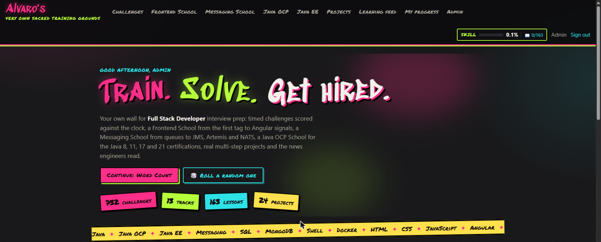
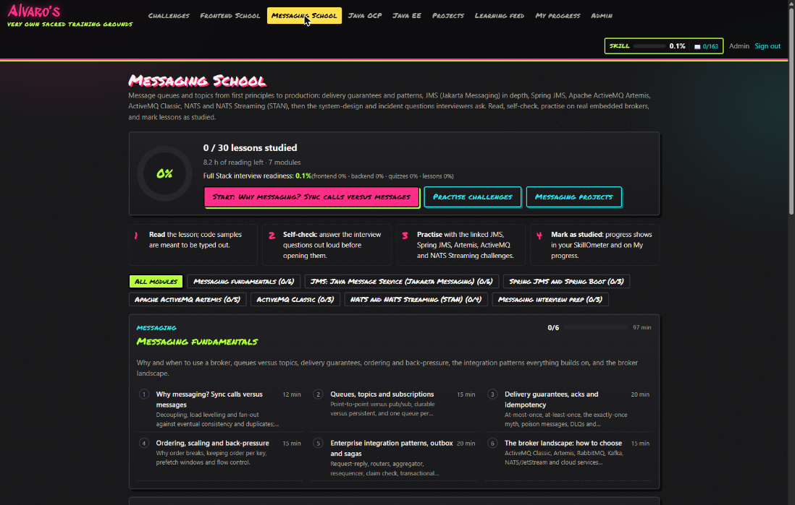
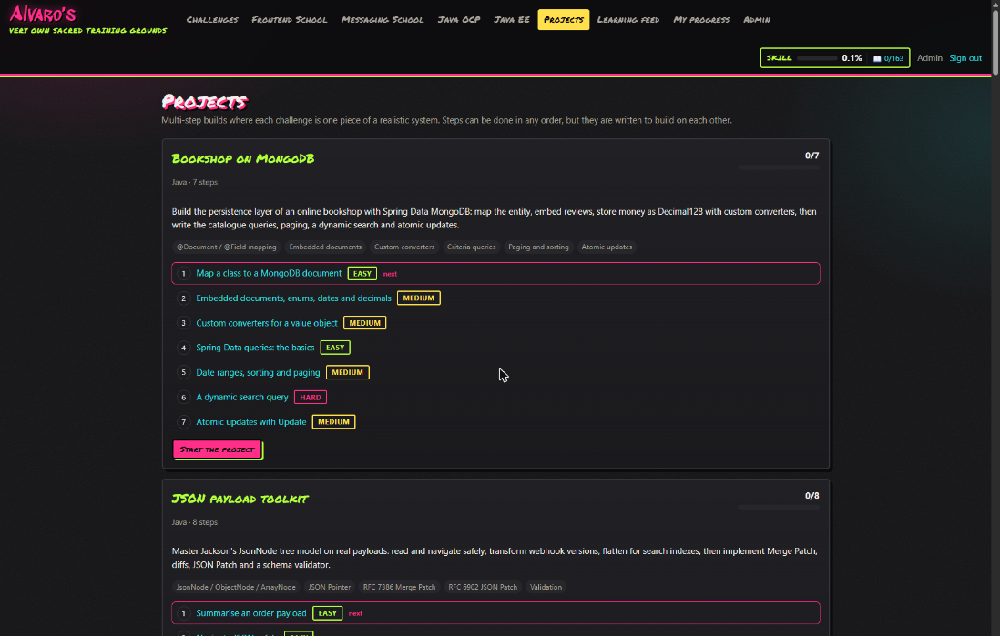
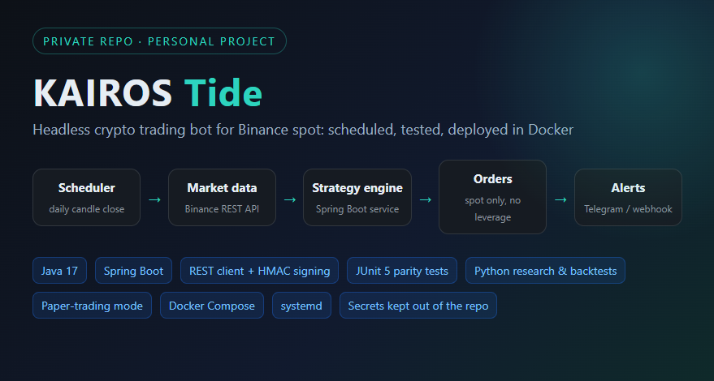
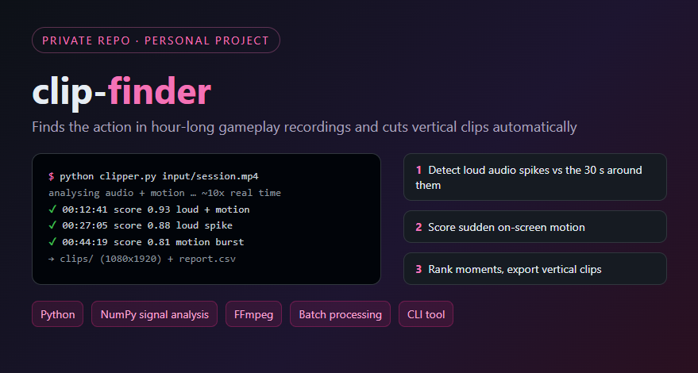

<h1 align="center">Hi, I'm Alvaro 👋</h1>
<h3 align="center">Java Backend Developer · Spring Boot & Microservices · Lisbon, Portugal</h3>

  
  
  

---

### 🧑‍💻 About me

- About **5 years** building backend systems for **banking, insurance and the public sector** (Banco BAI Europa, Caixa Geral de Depósitos, Santander, Crédit Agricole, Groupe Mutuel, Inditex, the Portuguese Social Security).
- I like **microservices and event-driven systems**, clean APIs, and software that still holds up after it ships: tests, observability, sensible design.
- Most recently I **upgraded services from Java 8 to 21**, moved inter-service communication from **SOAP and JMS to REST and gRPC**, and built **OpenTelemetry + ELK** monitoring.
- 🗣️ Portuguese · English · Spanish · French

### 🛠️ Tech stack

**Backend** 

**APIs & messaging** 

**Data** 

**Cloud, DevOps & observability** 

**Testing & frontend** 

### 💼 Experience

| When | Role | Clients |
|---|---|---|
| 2026 | **Back End Developer** · AdvanceWork | Banco BAI Europa |
| 2024 – 2026 | **Consultant** · Hexa Consulting | Groupe Mutuel, KLX (Crédit Agricole) |
| 2023 – 2024 | **Assistant Consultant** · Accenture | Caixa Geral de Depósitos, Santander |
| 2022 – 2023 | **Junior Consultant & Engineer** · Capgemini Engineering | Portuguese public sector & Social Security |
| 2021 – 2022 | **Junior System Engineer** · Minsait | Inditex |

---

## 🚀 Personal projects
*The code is private (client-style work and side projects), but here's what they look like.*

### 🏟️ DevArena: full-stack training platform
Spring Boot + Angular app with a **sandboxed code runner**: timed Java / SQL / MongoDB / Shell / Docker challenges checked against tests, multi-step projects, and schools for messaging (JMS, Artemis, NATS), Java EE and frontend. Runs as a **Docker Compose** stack (API, web, runner, PostgreSQL, MongoDB).

`Java 21` `Spring Boot` `Angular` `PostgreSQL` `MongoDB` `Docker Compose`

  
  

### 📈 KAIROS Tide: headless trading bot
Java 17 / Spring Boot service that trades Binance spot on a schedule and reports through Telegram. The Java code is checked against the Python research with **parity tests**, has a **paper-trading mode**, and deploys with Docker or systemd.

`Java 17` `Spring Boot` `REST + HMAC` `JUnit 5` `Python` `Docker`

### 🎮 clip-finder: automatic gameplay clipper
Python CLI that scans hour-long recordings for loud and high-motion moments and exports vertical clips for Shorts and Reels.

`Python` `NumPy` `FFmpeg` `CLI`

---

<i>Open to backend roles and freelance projects. Reach me through <a href="https://amgltp.com">amgltp.com</a> or <a href="https://www.upwork.com/freelancers/~014fa5e3098c7d3ef9">Upwork</a>.</i>

